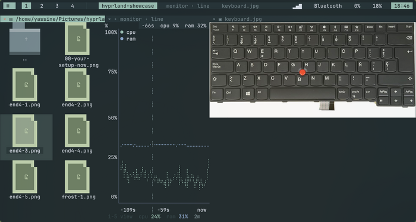
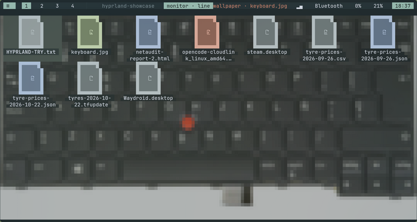
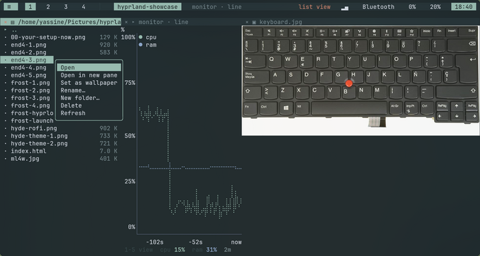

# termland

**A tiling window manager that lives inside one terminal tab.**

[](https://github.com/beav0team/termland/actions/workflows/ci.yml)
[](https://github.com/beav0team/termland/releases)
[](https://www.rust-lang.org)
[](LICENSE)
[](#tests)
[](#status)

No desktop environment. No X11. No compositor. One full-screen terminal, and
inside it: **tiled panes, real images, web pages, and every TUI you already
use** — btop, hx, lazygit, jiratui, Textual, Ratatui, Bubble Tea — with a split
tree, directional focus, workspaces, a desktop with a wallpaper, and a control
socket you can script from any other shell.



> **The end goal is a Linux distribution whose front end this is** — the thing
> you see after you log in, and the thing on the screen of the live ISO. No
> compositor, no toolkit, no session manager: kernel → DRM/KMS → termland →
> ptys → programs. kitty is the development host for `v0.1`, not the shipping
> target. The gap between the two is written out in [docs/DISTRO.md](docs/DISTRO.md).

## Why

There are two good answers to "how do I arrange my work", and both stop short:

| | Hyprland · i3 · sway | tmux · zellij |
|---|---|---|
| tiling + workspaces | yes | panes only, no window-manager semantics |
| images | yes | no |
| any program | no — GUI only | no — terminal only |
| scriptable | yes, via IPC | yes, via CLI |
| needs a desktop | **yes** | no |

**termland sits in the gap.** A window manager whose windows *are* terminal
programs: a real split tree with directional focus and workspaces, on top of
ptys, with pane types the multiplexers don't have — and it starts from a single
kitty window, so there is no session manager, no compositor and nothing
boot-critical to install.

## The desktop is part of it

An empty workspace is not an auto-spawned shell: it is the **desktop** — the
wallpaper and the icons of `~/Desktop`. `Super+D` puts the panes away and shows
it. Click an icon to select it, click again to open it; a folder opens a file
manager, a picture opens an image pane, anything else opens in an editor.
Arrows walk the grid, `Esc` puts the panes back, and the right button opens the
desktop's own menu.



Any picture can be the wallpaper — **Set as wallpaper** in either menu, or
`tlc wallpaper <path>`. It is sampled into the cell grid as half blocks (`▀`
puts one pixel row in the foreground and the next in the background), dimmed
toward the pane colour, and every icon name sits on a darkened pill, because a
photograph with white text on it is a photograph you cannot read. With no
picture chosen, the wallpaper is a dithered gradient painted cell by cell — no
image, no protocol, nothing to install.

## Menus, files, and the mouse



- **A built-in file manager** (`Super+E`): directories first, sizes on the
  right, double-click to open, and a right-click menu — Open, Open in new pane,
  Set as wallpaper (pictures only), Rename, New folder, Delete, Refresh — with
  rename/new-folder/delete dialogs. The rows are built from the selection, so
  the menu never offers an action that would not apply to what you picked.
  `v` switches between the list and an **icon grid**: every icon is a
  half-block bitmap drawn in three shades, four times the resolution of a font
  glyph and identical in every terminal. It is a pane type of its own, not a
  launcher for `yazi`.
- **An app menu** (`Super+R`) listing the pane types it can make (files,
  terminal, image, web, monitor, desktop) and the programs it finds on the
  machine, grouped by kind. `j`/`k`/`Home`/`End` and `Enter` drive it without
  the mouse.
- **A mouse that behaves like a desktop's.** Click a pane to focus it, click the
  `×` at the left of its header to close it, drag a divider to resize, wheel to
  scroll. Programs that ask for mouse reporting (`btop`, `hx`, `nmtui`) get real
  clicks, positions and wheel events, encoded back into the mode they requested
  (SGR 1006 or legacy X10). Buttons hover, rows hover, dividers show a resize
  cursor, and the pointer shape is asked for with `OSC 22`.

## Tiling

- **A binary dwindle split tree.** `auto_dir` cuts the long side of the focused
  pane, the way Hyprland's dwindle does. Closing a pane collapses its parent and
  promotes the sibling — the tree never holds a one-child node.
- **Directional focus by geometry**, not by tree order: among panes on the
  correct side, the closest one along the travel axis, then the smallest
  perpendicular offset.
- **Workspaces** `1`…`9`, created lazily, each with an independent tree.
- **Zoom** any pane full-width without touching the tree.
- **Pane types**: terminal, image, web (`w3m`), file manager, live monitor.
  An image pane is a leaf like any other — it splits, zooms and closes with the
  same code, because it is not a special case in the layout.
- **Real images** via the kitty graphics protocol with Unicode placeholders,
  falling back through sixel, iTerm2, and halfblocks.

## Keys

**Super is the desktop key**, matching Hyprland's default map. Under a running
compositor some of these are grabbed by it first (`Super+E` is Dolphin on
Plasma, for instance) — inside termland's own session, where it *is* the
desktop, every one of them arrives. The terminal asks the host for the kitty
keyboard protocol with `REPORT_ALL_KEYS_AS_ESCAPE_CODES`, which is what makes
`Super` deliverable at all: without it the modifier cannot be represented and
the chord vanishes.

| key | action | key | action |
|---|---|---|---|
| `Super+Q` | close pane | `Super+E` | file manager |
| `Super+D` | the desktop | `Super+G` | live graphs |
| `Super+R` | app menu | `Super+V` | flip the split |
| `Super+F` `Super+Z` | zoom pane | `Super+N` / `Super+Enter` | new shell |
| `Super+H` `J` `K` `L` | focus left/down/up/right | `Super+Shift+H` `J` `K` `L` | move pane |
| `Super+←↑↓→` | focus | `Super+Shift+←↑↓→` | move pane |
| `Super+1`…`9` | workspace | `Super+Shift+1`…`9` | send pane to workspace |
| `Super+=` / `Super+-` | resize | `Super+M` | quit termland |
| `Super+?` | keymap overlay | `Super+Tab` | cycle panes |

The **leader is still `Ctrl+Space`** for people who prefer it:

| key | action | key | action |
|---|---|---|---|
| `v` `\|` | split side-by-side | `s` `-` | split stacked |
| `h` `j` `k` `l` | focus left/down/up/right | `H` `J` `K` `L` | resize that edge |
| `Tab` `]` | next pane | `[` | previous pane |
| `n` | new shell | `i` | new image pane |
| `w` | new web pane (`w3m`) | `f` `z` | zoom / unzoom |
| `q` `x` `d` | close pane | `?` | keymap overlay |
| `1`…`9` | switch workspace | `Space` | send a literal `Ctrl+Space` |

In the file manager: `Enter` opens, `v` switches list/icons, `r` renames, `n`
makes a folder, `d` deletes (with a `y/n` confirm), `.` toggles hidden files,
`q` closes it. On the desktop the arrows walk the grid, `Enter` opens, and `Esc`
leaves.

## Install

From the [latest release](https://github.com/beav0team/termland/releases):

```sh
curl -L -o termland.tar.gz \
  https://github.com/beav0team/termland/releases/latest/download/termland-0.1.0-x86_64-linux.tar.gz
tar xzf termland.tar.gz && cd termland-0.1.0
install -Dm755 termland             ~/.local/bin/termland
install -Dm755 tlc                  ~/.local/bin/tlc
install -Dm755 contrib/tl           ~/.local/bin/tl
install -Dm644 contrib/kitty.conf   ~/.config/termland/kitty.conf
```

Or from source:

```sh
sudo apt install kitty build-essential pkg-config   # kitty is the host, not a dependency of the build
git clone https://github.com/beav0team/termland && cd termland
cargo build --release
install -Dm755 target/release/termland ~/.local/bin/termland
install -Dm755 target/release/tlc      ~/.local/bin/tlc
install -Dm755 contrib/tl              ~/.local/bin/tl
install -Dm644 contrib/kitty.conf      ~/.config/termland/kitty.conf
```

Then:

```sh
tl                  # kitty + termland, one full-screen terminal
tl --demo           # three-pane demo: monitor · editor · image
termland -- hx .    # run it inside any kitty window you already have
termland --image ~/shot.png
```

### Requirements

Linux, Rust **1.88+**, a C toolchain (for `portable-pty`), and kitty. Image
panes want a terminal that speaks kitty graphics (kitty, ghostty, WezTerm) or
sixel (foot, mlterm); anywhere else the image still shows up as halfblocks.

**Uninstall is a deletion.** No system files, no boot changes, no service
units: remove the three binaries, `~/.config/termland` and the checkout, and
nothing is left behind.

## Scripting

Every action is available over a unix socket — one tab-separated line per
request, no JSON, no quoting rules:

```sh
tlc split v                  # cut the focused pane left|right
tlc run btop                 # new pane running any program
tlc image ~/Pictures/a.png   # new image pane
tlc web https://example.com  # new pane running w3m
tlc files ~/Documents        # new file-manager pane
tlc chart                    # new live monitor pane
tlc view icons               # focused file pane: list or icon grid
tlc desktop on               # show the desktop; `tlc desktop` asks if it is on
tlc wallpaper ~/p/ridge.png  # use a picture; `tlc wallpaper clear` goes back
tlc keys "make test\r"       # type into the focused pane
tlc key super+e              # send a desktop chord
tlc mouse 60 30 move         # move the pointer (hover), or click
tlc focus l && tlc zoom      # focus right, then zoom it
tlc list                     # id, kind, title, geometry, focus marker
tlc layout                   # WxH, workspace, pane count
tlc quit
```

```console
$ tlc list
8	files	hyprland-showcase	34x31
10	chart	monitor · line	34x31	*
9	image	keyboard.jpg	67x31
```

Because the socket is a plain line protocol, `nc` works too:

```sh
printf 'split v\n' | nc -U "$XDG_RUNTIME_DIR/termland.sock"
```

`tlc` has **zero dependencies** on purpose: it is the scriptable surface of the
window manager, so it must build and run anywhere, instantly. The socket lives
at `$XDG_RUNTIME_DIR/termland.sock`, or `$HOME/.run/termland.sock` when the
session has no runtime dir (never `/tmp`, which is world-writable), is mode
`0600`, and can be overridden with `TERMLAND_SOCKET`.

## How it works

```
                      ┌──────────────────────────────────────────┐
   keyboard ─────────▶│ crossterm::read  (one input thread)      │
                      └───────────────────┬──────────────────────┘
                                          │ Msg::Input
   pty A ── reader ──┐                    ▼
   pty B ── reader ──┼──── Msg::Output ─▶ channel ─▶ main loop ──▶ surface
   pty C ── reader ──┘                    ▲             │
                                          │             ├─▶ vt100::Parser (per pane)
   tlc ── unix socket ── ipc thread ──────┘             │
                                          Msg::Ipc      └─▶ App: layout tree, focus,
                                                            workspaces, keymap
```

| piece | crate | job |
|---|---|---|
| split tree | own | dwindle tree, geometry, directional focus — pure data, no server |
| panes | `portable-pty` + `vt100` | real ptys, full ANSI parsing, one thread per pane |
| drawing | `ratatui` + `crossterm` | a single cell grid behind a `Surface` trait |
| images | `ratatui-image` | kitty graphics → sixel → iTerm2 → halfblocks |
| charts | `tui-chart` + `sysinfo` | the monitor pane's samples |
| control | own | unix socket, one line per request |

**There is no server.** No daemon, no attach/detach, no persistence layer.
termland owns the ptys, so when it exits the children get `SIGHUP` from the
kernel as the pty master closes. That removes an entire category of bug and
most of the code a multiplexer normally needs.

**The vt100 parser is only ever touched from the main thread.** Pane reader
threads push bytes into one channel; input events use the same channel. The
main loop is: `recv`, batch up to 256 messages, draw. There are no locks in the
hot path, and a chatty pane cannot starve the renderer.

**The surface boundary is real.** `surface.rs` owns the frame, the cursor and
the `Surface` trait; `App` never names `ratatui::Terminal`. A GPU or DRM
frontend replaces one file and keeps the other twelve modules.

**Keys are re-encoded, not forwarded.** `crossterm` hands us a `KeyEvent`;
`keys::encode` turns it back into the xterm sequence the child expects,
including the `ESC[1;{m}` modifier forms and the `ESC O`/`ESC[15~` split
between F1–F4 and F5–F12. It is pure, dependency-free and unit-tested, which is
the only way this stays correct over time.

**Children get `TERM=xterm-256color`, not `xterm-kitty`.** A pane is a pane. A
program inside one must not decide it can draw over the whole screen.

**The loop has a clock.** 250 ms when nothing moves, 16 ms while something is
animating: a hover fade is smooth and an idle desktop costs ~2 % of one core.
`anim.rs` clamps `dt` so a two-second stall cannot become one two-second
animation step.

## Status

**Alpha.** `v0.1` is the "host tier": split tree, directional focus, resize,
zoom, workspaces, ptys with full ANSI, key re-encoding, image panes with
protocol fallback, web panes, a file manager with two views, a desktop with
wallpaper and icons, menus, and the `tlc` socket — all inside kitty.

Alpha means **run it next to your desktop, not instead of it**. There is no
login/session integration yet, no GPU frontend, and the config format and
keybindings can still change between commits. "It compiled" is not "it is ready
to be your only session"; [docs/DISTRO.md](docs/DISTRO.md) lists what has to be
true before it is.

Not here yet, deliberately:

- scrollback paging (2000 lines are parsed and kept, just not browsable)
- mouse text selection and copy (clicking, scrolling and forwarding work)
- session persistence across restarts
- a searchable command palette

### Where this is going

The target is a distro front end, so the tiers are ordered by *what has to be
true for an image to ship*, not by what is interesting to write:

| # | milestone | proves | status |
|---|---|---|---|
| 0 | `v0.1` on kitty | the model works: tree, ptys, images, IPC | **done** |
| 0b | desktop interaction | mouse, menus, file manager, Super bindings | **done** |
| 1 | session under `greetd` | it can be a login session, not an app | |
| 2 | `surface` trait + kitty surface | the frontend boundary is real | **done** |
| 3 | GPU frontend (`wgpu` + `glyphon`) under `cage` | it can be the whole screen on real hardware | |
| 4 | bundled font, config, logging | it can ship in an image | logging + config done, font pending |
| 5 | an ISO that boots to termland | it is a distro | |
| 6 | direct DRM/KMS | no compositor at all | |
| 7 | IME, clipboard, AT-SPI | it is a desktop people can live in | |

Milestone 5 turns this from a good idea into a product. Milestone 7 decides
whether it is a usable product or a beautiful demo — input methods for Arabic,
Chinese or Japanese need `text-input-v3` or a direct IM protocol, and without
them the distro cannot be typed into. The reasoning, including why `chafa` is
an optional feature and why a wlroots host may be needed longer than planned,
is in [docs/DISTRO.md](docs/DISTRO.md).

## Tests

```console
$ cargo test
test layout::tests::rects_tile_the_window_without_overlap ... ok
test layout::tests::split_then_remove_collapses_cleanly ... ok
test keys::tests::every_modifier_combo_roundtrips_to_a_nonempty_sequence ... ok
test ipc::tests::never_falls_back_to_tmp ... ok
test wallpaper::tests::a_crop_keeps_the_aspect_ratio ... ok
...
test result: ok. 162 passed; 0 failed
```

The ones that earn their keep:

- `rects_tile_the_window_without_overlap` — the sum of every leaf's area must
  equal the window's. Catches off-by-one rounding in the split geometry, which
  is the classic way a tiler grows a one-pixel gap.
- `every_modifier_combo_roundtrips_to_a_nonempty_sequence` — every
  `(key, modifier)` pair must produce a well-formed escape sequence. Catches the
  key encoder dropping a chord silently.
- `run_with_timeout_gives_up_on_a_slow_command` — a hung `nmcli` must not hang
  the panel. The test runs `sleep 5` with a 50 ms budget and asserts we returned
  long before the sleep could finish.
- `never_falls_back_to_tmp` — the `tlc` socket may live in `$XDG_RUNTIME_DIR`
  or `$HOME/.run`, never in world-writable `/tmp`.
- `sgr_encoding_is_one_based_relative_to_the_pane` — a click has to reach the
  child as one-based coordinates *inside its own screen*, or every mouse-aware
  program draws a cursor one cell off.
- `every_menu_row_is_clickable_and_nothing_else_is` — the menu you see and the
  menu you click come from one geometry function, so a border is never a hit.
- `a_dialog_swallows_typing_so_it_cannot_reach_a_shell` — typing a folder name
  must not leak a `q` into the shell and close the pane behind the dialog.
- `a_crop_keeps_the_aspect_ratio` — the wallpaper must fill the desktop without
  stretching it, and must survive a pane that is wider than the picture.

## License

MIT. Built on a ThinkPad X280 with no usable GPU, which is why the release
profile is `opt-level = 2` with thin LTO rather than fat LTO: the thing should
build while you wait for coffee, not after it.
